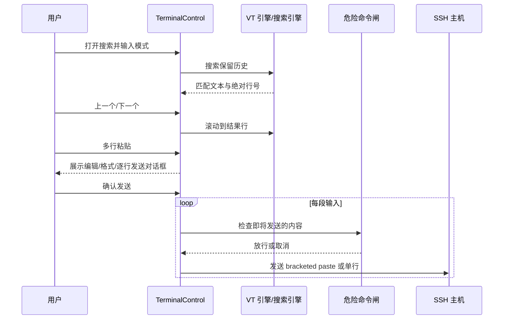

# SSH 终端交互体验

## 1. 目标与边界

目标用户是在 SSH shell、tmux 和 TUI 程序间切换的运维人员。让用户能搜索配置的完整回滚缓冲、用常见鼠标手势复制文本、在发送多行剪贴板内容前检查它，并在远端鼠标模式、本地菜单与粘贴之间明确切换。滚轮动作按输入设备增量处理；本地命令补全不应截获远端程序输入。

成功标准：历史区的搜索结果可逐个跳转且方向正确；单词/整行选择可复制；多行粘贴可预览、编辑、按行发送且继续通过危险命令闸；右键及中键行为符合连接配置；触控板滚轮不会被放大成固定三行；终端失焦光标仍可见，启用设置后键入时隐藏鼠标指针、移动鼠标即恢复；TUI 输入路径不弹本地 shell 补全框。

明确不做：放宽 100,000 行回滚上限；实现矩形/列选择、shell 提示符解析或远端文件路径补全；引入新鼠标/终端依赖；在无实测内存基线时更改 scrollback 默认值或上限。

## 2. 行为增量

### ADDED
- VT 搜索覆盖当前 normal buffer 的全部保留历史，并按结果行定位；搜索结果总数与当前序号准确。
- 双击选择词、三击选择行；连接偏好启用 CopyOnSelect 时，在本地选区完成后复制。
- 短单行粘贴直接发送；多行、长文本和含 Tab 的内容先预览编辑。逐行发送显示进度，支持取消并报告实际发送行数；所有发送仍走危险命令检查。
- 右键行为可配置本地菜单、远端鼠标事件或粘贴；中键在没有远端鼠标上报时粘贴。
- 鼠标滚动按 delta 累积映射为本地行数或远端滚轮事件。
- 失焦时块光标绘制为空心轮廓；配置启用后，终端键入期间隐藏鼠标指针，鼠标移动或失焦恢复。

### MODIFIED
- 搜索首个匹配、上一个、下一个都会定位到对应历史行，越界时按结果序号循环。
- 本地补全只作用于 LocalTerminalSession / 本地行缓冲；VT SSH 和 TUI 按键/Tab 交给远端应用。
- 已配置 CopyOnSelect 与 TrimTrailingWhitespace 开始影响复制结果；默认行为维持不自动复制，尾部空白默认裁剪。

### REMOVED
- 移除 VTCell SSH 输入路径中本地历史/内置候选弹窗对远端按键的接管。

## 3. 设计与契约

### 3.1 名词层

- `TerminalProfile` 继续作为连接级终端交互偏好的事实源；扩充右键粘贴模式与输入时隐藏鼠标指针偏好。已有 `ContextMenu`、`Remote` JSON 值保持兼容。
- `TerminalSearchEngine` 保存匹配文本和绝对历史行索引；`VtTerminalEngine` 提供分块读取保留历史与绝对行滚动入口。`LightweightRenderer` 保持现有可见屏幕行为。
- `TerminalSelection` 保留线性选区模型；渲染器识别点击次数并生成词/整行边界，不新增列选区状态。
- `TerminalPasteDialog` 只编辑粘贴缓冲和发送选项，不直接访问会话；确认后由 `TerminalControl` 逐段发送。

### 3.2 编排层

**现状**：`GetScreenText()` 只返回当前可见页；搜索栏另外截取 500 行。`FindAndScrollTo()` 向下遍历的终点等于起点。鼠标只支持拖选，右键菜单/远端模式已有，`CopyOnSelect` 未接入，粘贴直接读取剪贴板；滚轮每个事件固定处理 3 格；VTCell 下本地 `_commandLine` 补全可能接管远端输入。

**变化**：搜索从 VT 引擎分块枚举 normal buffer 历史，匹配结果直接以绝对行索引导航；alternate screen 不暴露 normal scrollback。UI 鼠标事件按优先级处理链接、选择手势、粘贴、远端事件和本地菜单。粘贴对话框确认后按行调用既有危险闸及 bracketed-paste 协议。VT SSH 路径不维护用于弹窗补全的本地命令状态。

**流程约束**：历史分块大小固定且有界，搜索失败保持原视口；越界索引不改变状态。粘贴取消/关窗不发送任何字节。危险闸拒绝某行后停止后续逐行发送。鼠标 Hide/Show 只平衡本组件执行过的状态，并在失焦和销毁路径恢复。

### 3.3 挂载点

- 连接属性「终端」区：新增右键粘贴/隐藏鼠标指针偏好，既有光标与右键设置保留。
- 终端 `MouseDown/MouseUp/MouseWheel`：接入选择手势、粘贴模式与 delta 滚动。
- 终端搜索栏：搜索、结果导航改用完整回滚缓冲。
- 多行粘贴菜单与快捷键：共用对话框和发送管线。

### 3.4 推进策略

1. 历史枚举、绝对行滚动和双向搜索；纯逻辑测试覆盖页边界与循环导航。
2. 单击/双击/三击选择和配置驱动复制；选择文本纯逻辑测试覆盖 Unicode 与分隔符。
3. 粘贴编辑/格式化/逐行发送，并接入按钮、快捷键、右键和中键；纯逻辑测试覆盖取消、危险闸停止及换行。
4. delta 滚轮映射、TUI 补全隔离、光标焦点反馈和鼠标指针恢复。
5. 运行相关单测、项目静态门禁、目标构建；在可用 Windows 桌面验证真实鼠标/键盘与粘贴场景。

### 3.5 结构健康度与微重构

##### 评估
- 文件级：`TerminalControl.cs` 已超过 1000 行，但本次 UI 调整沿用其 partial 文件和现有事件归属；纯粘贴 UI 独立为 Form，粘贴转换规则放入可测纯逻辑。
- 文件级：`VtTerminalEngine.cs` 承载终端 buffer 与滚动状态；历史分页枚举仍由引擎负责，不向 UI 暴露 VtNetCore 内部 controller。
- 目录级：`src/Gdterm.UI/Forms`、`src/Gdterm.Tests/Terminal` 有成熟同类窗体/纯逻辑测试，本次新增各一个文件，不造成目录摊平。

##### 结论：不做

本 feature 不重划职责或依赖方向。

## 4. 验收契约

- 历史超过 500 行时，搜索返回超过可见区域的匹配且点击结果后视口定位正确；同一查询可从首条向下、向上循环。
- 双击选择词、三击选择整行；跨 CJK/emoji 选择文本完整；CopyOnSelect 关闭不自动复制，开启后复制选区且遵循尾空格偏好。
- 短单行粘贴无额外确认窗且仍经过危险命令闸；多行、超长与含 Tab 文本可编辑预览；LF/CRLF 与 Tab 处理可预期；逐行模式可见进度、取消并报告部分发送数，遇到取消/拒绝后不发送后续行；bracketed paste 标记正确。
- 右键三种模式、Shift 覆盖规则、中键在鼠标追踪开/关时无歧义；未连接时不粘贴或转发。
- 多个 `MouseWheel` delta 合计与一个完整滚轮刻度等效；触控板小 delta 不被放大。
- 本地 Shell 可用原有本地补全；VT SSH/TUI 的 Tab、箭头键原样交给远端。
- 失焦块光标呈空心、焦点恢复正常；隐藏鼠标指针选项默认关闭，打开后键入隐藏、移动和失焦恢复。
- 连接旧 `terminalProfile` JSON 能读取，新设置可序列化往返；scrollback 最大值保持 100,000。

## 5. 与项目级架构文档的关系

能力落在现有 Core 连接偏好、Terminal buffer/渲染和 UI 交互模块，未改变系统级模块关系；acceptance 不回写 architecture。

## 6. 执行计划

- [x] 搜索历史与结果导航 — 全保留行枚举、绝对行定位、正反向循环导航已接线；搜索引擎测试已注册。
- [x] 鼠标选择与复制偏好 — 双击词、三击行、尾空白和自动复制已接线；字符列映射覆盖宽字符。
- [x] 粘贴预览与鼠标按钮行为 — 短单行直发，多行/长文本/Tab 弹出 AntdUI 编辑预览；逐行发送显示当前行、支持取消且报告完成/中断行数；键盘、鼠标与程序发送入口在发送期间受忙碌闸保护；危险闸及右键/中键入口已接入。
- [x] 滚轮、补全与光标反馈 — 滚轮增量累积、VT 补全隔离、焦点轮廓及输入时隐藏指针已接线。
- [ ] 综合验证 — Roslyn 与静态门禁通过；完整测试 harness 受缺少 .NET Framework 4.6.2 targeting pack 阻断，真实 Windows 桌面场景待验。

## 7. 执行证据

2026-11-21：
- `tools/csc-check.sh` 通过，369 个 C# 源文件无编译错误；保留 6 条既有警告。
- `tools/check-csproj-files.py` 通过，13 个工程、0 项清单问题。
- `tools/check-i18n.py`、`tools/check-encoding.py`、`tools/ui-ux-lint.py`、`git diff --check` 均通过。
- `$HOME/dotnet/dotnet build src/Gdterm.Tests/Gdterm.Tests.csproj --no-restore` 未能构建：环境缺少 .NET Framework 4.6.2 targeting pack（MSB3644）；使用缓存引用程序集覆盖后，旧式项目仍因 SSH.NET/KeePassLib 引用未由项目恢复而无法构建。本次新增纯逻辑测试已注册但未运行。
- Linux 无 WinForms 桌面和剪贴板交互环境；Windows 鼠标、按键、焦点、粘贴和危险闸人工验收未执行。
- 追加体验优化：短单行粘贴直发；多行/长文本/Tab 走 AntdUI 预览，新增可取消的逐行进度窗；发送期间阻止键盘、鼠标和其它命令插入，并显示完成/取消/异常时实际发送行数。纯逻辑策略单测已补；静态编译与页面契约更新见本次验证结果。Windows 窗体和剪贴板交互仍待目标桌面验收。
- 追加静态复核：`tools/ui-ux-lint.py`、`tools/check-i18n.py`、`tools/check-encoding.py`、`tools/check-csproj-files.py`、`tools/feature-map.py --check` 和 `git diff --check` 均通过；页面矩阵现为 48 页、0 个未登记缺口。

## 8. 验收结果

静态与 Roslyn 编译验收通过。代码路径覆盖已对照设计契约检查；自动单测执行和 Windows 桌面验收仍受当前环境限制，故不标记 feature 完成。

## 9. 遗留事项

Windows 桌面验收：右键三模式及 Shift 覆盖、中键与远端鼠标模式、双击/三击和自动复制、触控板小 delta、TUI Tab/方向键直通、粘贴取消/逐行危险命令拒绝、光标失焦轮廓及鼠标指针恢复。
